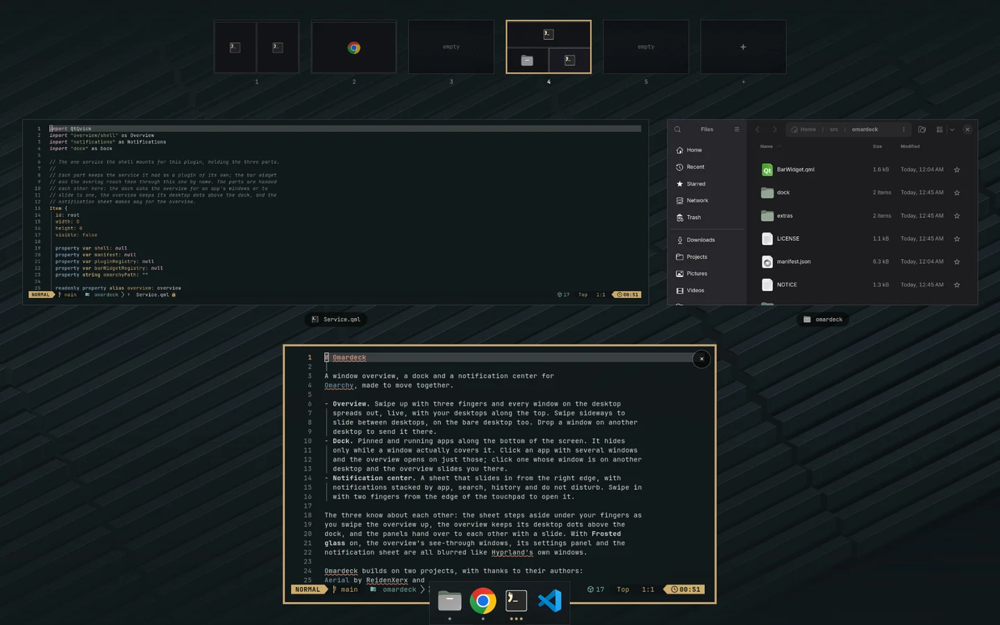
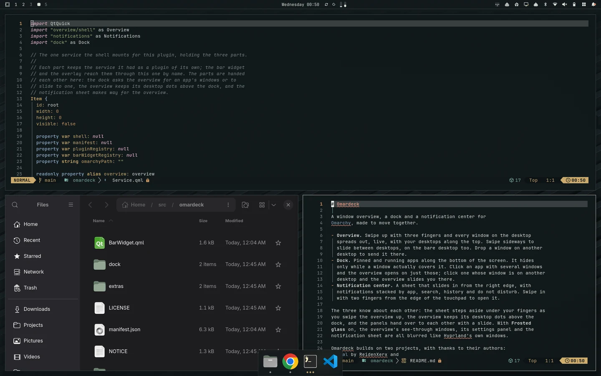
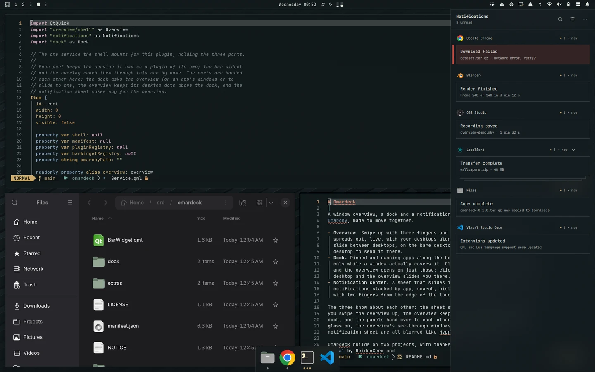
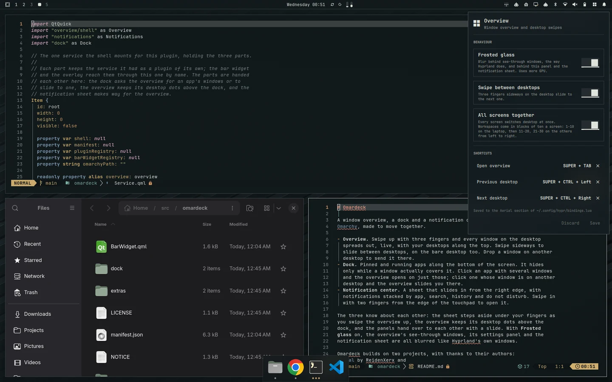

# Omardeck

A window overview, a dock and a notification center for
[Omarchy](https://omarchy.org), made to move together.



- **Overview**, from [Aerial](https://github.com/ReidenXerx/omarchy-aerial)
  by ReidenXerx. Swipe up with three fingers and every window on the desktop
  spreads out, live, with your desktops along the top. Swipe sideways to
  slide between desktops, on the bare desktop too. Drop a window on another
  desktop to send it there.
- **Dock.** Pinned and running apps along the bottom of the screen. It hides
  only while a window actually covers it. Click an app with several windows
  and the overview opens on just those; click one whose window is on another
  desktop and the overview slides you there.
- **Notification center**, from
  [Foamy Notification Center](https://github.com/foamrider/foamy-notification-center)
  by foamrider. A sheet that slides in from the right edge, with
  notifications stacked by app, search, history and do not disturb. Swipe in
  with two fingers from the edge of the touchpad to open it.

| | |
|---|---|
|  |  |
| The dock | The notification center |

The three know about each other: the sheet steps aside under your fingers as
you swipe the overview up, the overview keeps its desktop dots above the
dock, and the panels hand over to each other with a slide. With **Frosted
glass** on, the overview's see-through windows, its settings panel and the
notification sheet are all blurred like Hyprland's own windows.

Omardeck builds on two projects, with thanks to their authors:
[Aerial](https://github.com/ReidenXerx/omarchy-aerial) by ReidenXerx and
[Foamy Notification Center](https://github.com/foamrider/foamy-notification-center)
by foamrider. See [Credits](#credits).

## Install

Needs Omarchy with Hyprland's Lua configuration, plus `jq`, `wl-paste`,
GNU `timeout`, `inotify-tools`, `file` and ImageMagick 7 (`magick`) for the
notification center.

```sh
omarchy plugin add https://github.com/QuokeCola/omardeck.git
omarchy plugin enable quokecola.omardeck right
```

This puts the bell, and the overview's settings button beside it, at the
right of the bar. If you have Aerial, Foamy Notification Center or the
`quokecola.dock` plugin installed, disable them first: they would register
the same gestures and draw a second dock.

### Optional: swipe the notification center open

The two-finger edge swipe reads the touchpad directly (read-only; scrolling
keeps working), which needs permission to read it:

```sh
sudo cp ~/.config/omarchy/plugins/quokecola.omardeck/extras/70-omardeck-touchpad.rules /etc/udev/rules.d/
sudo udevadm control --reload && sudo udevadm trigger
```

The rule grants the logged-in user access to the touchpad only. Without it,
everything else works and the bell still opens the sheet.

## Use

- **Overview:** three fingers up to open, down to close, sideways to change
  desktop. Four fingers up shows every window on every desktop.
- **Settings:** the button beside the bell, dropping down from the bar. Frosted glass, desktop swipes,
  all screens switching together, and keyboard shortcuts (written to their
  own section of `~/.config/hypr/bindings.lua`).
- **Notification center:** click the bell, or swipe in from the right edge.
  Its own settings are under **⋯** in the sheet. More in
  [notifications/README.md](notifications/README.md).



### All screens together

With this on, every screen switches desktop at once, and workspaces are
numbered in blocks of ten a screen: 1–10 on the laptop, 11–20 on the next
screen to the right, 21–30 on the one after. Desktop 3 is workspace 3 on the
laptop and 13 and 23 on the others. Number keys that switch every screen at
once have to be bound the same way in your Hyprland config.

### The dock

Configured in `~/.config/omarchy/dock.json`, which the dock watches. Pinning
and unpinning from an icon's right-click menu writes it for you. See
[extras/dock.example.json](extras/dock.example.json):

| Key | Default | |
|---|---|---|
| `pinned` | `[]` | desktop file ids, without `.desktop` |
| `iconSize` | `38` | icon size in pixels |
| `height` | `63` | dock height in pixels |
| `magnify` | `1.45` | hovered icon scale; `1` turns it off |
| `autohide` | `"smart"` | `"smart"` hides only while a window covers the dock; `"always"`, `"never"` |
| `slideToWindow` | `true` | the overview slides to a window on another desktop; `false` switches at once |
| `windowPicker` | `"aerial"` | an app with several windows opens the overview on them; `"cycle"` focuses them in turn |
| `classAliases` | `{}` | `{"<regex on window class>": "<desktop id>"}` for apps whose window class matches no desktop file |

## Layout

| Folder | Part | Based on |
|---|---|---|
| `overview/` | the window overview and its settings | Aerial |
| `notifications/` | the notification center | Foamy Notification Center |
| `dock/` | the dock | |

`Service.qml` holds the three parts and hands them to each other;
`BarWidget.qml` is the bar button pair. The READMEs inside `overview/` and
`notifications/` are the original projects' documentation and describe them
as separate plugins.

## Credits

- **Aerial** by DuduPhudu (ReidenXerx),
  <https://github.com/ReidenXerx/omarchy-aerial>, MIT. The overview, the
  gestures and the Hyprland blur port are Aerial's; Omardeck adds to them.
- **Foamy Notification Center** by foamrider, with contributions by Tomas
  Kirkegaard, <https://github.com/foamrider/foamy-notification-center>, MIT.
  It includes Lucide icons (ISC) and code derived from Omarchy (MIT).
- The full history of both is kept in this repository, with their authors.

Omardeck is an independent project. It is not affiliated with or endorsed
by the authors of Aerial or Foamy Notification Center, or by Omarchy.

## License

MIT, see [LICENSE](LICENSE). The code in `overview/` and `notifications/`
stays under its own licenses, listed in [NOTICE](NOTICE).
