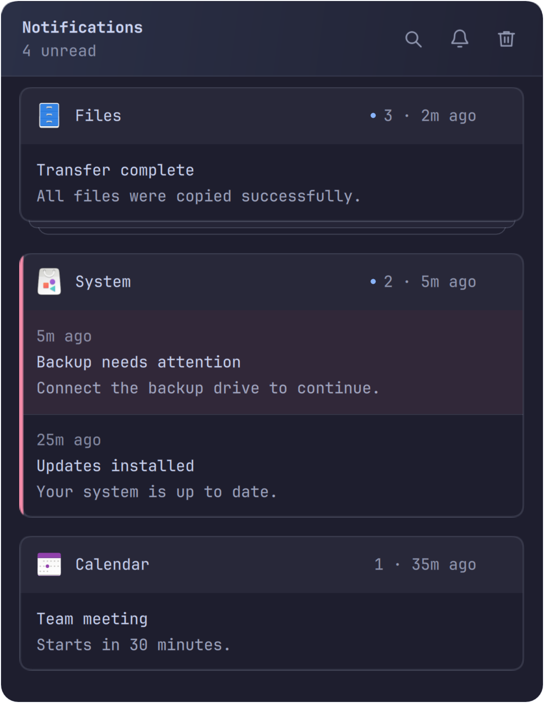

> **In Omardeck:** this is the original project's documentation, kept for reference. It describes it as a plugin of its own; install Omardeck instead, as in the [main README](../README.md).

# Foamy Notification Center

Notification history with app stacks, search, and do not disturb.



## Install

Requires Omarchy with stock notifications enabled, `jq`, GNU `timeout`, `setpriv` (util-linux),
and `inotify-tools`. Website favicon lookup uses the system Python 3 runtime.

File-backed app icons, attached images, and picture previews require `file` and
ImageMagick 7 (`magick`). PNG, JPEG (including progressive JPEG), GIF, and WebP
files are converted outside the shell to a single PNG of at most 720 × 720 pixels.
BMP/ICO and self-contained SVG app icons and attached images are also supported.
SVG uses librsvg through ImageMagick in an empty working directory; external
resources are unavailable. Transparency and aspect ratio are preserved; themed
app icons still resolve normally.
Conversion uses a plugin-local policy: no delegates or disk pixel cache, an
8,192-pixel width/height limit, a 128 MiB pixel cache, a 512 MiB process memory
limit, and a five-second timeout (forced termination after one further second).
Unsupported, oversized, or failed images are omitted; notification text remains
archived and app icons fall back to the app glyph. Missing conversion tools also
omit file-backed images rather than exposing originals to the shell. Rows from
before images were converted lose their picture and keep their text. Opening a
picture still uses its original file.

```sh
omarchy plugin add https://github.com/foamrider/foamy-notification-center.git --enable
```

## Use

- Click the bell to open the center. Click an app heading to expand its stack.
- Click a notification body to open its picture or focus the sending app,
  including the visible card in a collapsed stack.
- Hover to dismiss a stack or individual notification. The trash clears the panel.
- Click search or press `/` to filter. Press Escape to close search.
- Open **More options (⋯)** to silence/allow notifications or open **Settings**.
  Right-clicking the bar icon also toggles do not disturb.
- Clear all stays next to search. Stack dismissal uses the X icon,
  shown on hover or keyboard selection. Both ask once, in the row they act on,
  with focus on Keep. A single notification never asks.
- From the top of the list, Up reaches Clear all and More; Left and Right move
  between them, Enter acts, Down or Escape goes back. Tab still switches panels.

Settings use the shell's own controls. They change this widget's browser grouping,
favicons, compact view, pictures, retention (days), and maximum archive count, and
save immediately through Omarchy's widget settings IPC. Invalid values and save
failures are shown in the panel. Back or Escape returns from Settings.

Set `useBrowserFavicons` on the widget entry to `true` (default) to show a
website’s locally cached favicon, with the app icon and then the glyph as
fallbacks. Set `browserGrouping` to `"browser"` (default), `"hostname"`, or
`"none"`. Hostname mode gives each identified website its own stack and heading;
none leaves each browser notification separate. Native apps keep their stacks.
Missing website identities remain under the browser. A browser-wide stack with
several websites keeps the browser icon because it has no single website identity.

For example, on the widget entry:

```json
"useBrowserFavicons": true,
"browserGrouping": "hostname"
```

Website identity comes only from a browser’s leading HTTP(S) URL/link or a bare
hostname on its own first line. Links inside the message and sender avatars do
not identify the site. Grouping does not change click targets or distinguish
browser profiles/accounts.

Favicons are read asynchronously from standard Linux Vivaldi, Chrome, Chromium,
Brave, Edge and Opera profile caches. Firefox, custom profile locations and missing
icons fall back to the app icon. This also works with stock Omarchy notifications
when the sender’s website origin is present in the archived body. No website
requests or additional Python packages are used. PNG copies use the shared private cache
at `$XDG_CACHE_HOME/foamy/browser-favicons` (normally `~/.cache/foamy/browser-favicons`),
limited to 256 icons of at most 64 KiB and 256 × 256 pixels. Successful lookups
refresh after one day; missing icons can retry after five minutes on a display
model change. Lookups cover only the first 128 groups in the display.

Browser databases are opened read-only. If a rollback database is locked, the
helper can read an in-memory copy of at most 32 MiB. It rejects active
journals, WAL sidecars, changed files and copies that fail SQLite's integrity
check. Copying and querying share a two-second deadline. No database copies are
written to disk; the helper never writes to the browser database or removes its
locks. A cache that cannot be read safely keeps the app icon and reports
`cache-unavailable`.

Set `compact` on the widget entry in `shell.json` to `true` for a slim app
header and tighter message spacing. The default, `false`, keeps the roomier
cards. Text and picture sizes stay unchanged.

The center is a translucent sheet down the right edge of the screen, from
under the bar to the bottom, and slides in and out from that edge. Opening,
closing, folding, and unfolding all use `cubic-bezier(0.8, 0, 0.2, 1)`.

Stacks fold the way macOS folds them: each card slides behind the front card,
shrinking slightly, and settles on the stack edges drawn beneath it; unfolding
brings the cards back out from behind it. Urgent notifications carry a line
beside the card, tinted with the sending app's icon colour (or the theme's
urgent colour for an icon without one), which tucks behind its card as the
stack folds.

New cards fade in with an 8 px lift over 180 ms and fade out over 120 ms on
removal. The departed row then collapses over 140 ms so remaining cards move
smoothly.
Message updates retain their card, and scrolling does not replay the entrance.

Keeps up to 1,000 notifications for 30 days by default. Silenced notifications
remain in history; stock Omarchy exceptions still apply.

The default `clickAction: "Auto"` opens an absolute PNG, JPEG, GIF, or WebP path,
or focuses the sending app when no image is available.
The standard two-argument `tensaku-edit` screenshot action becomes a fixed
`edit-screenshot` intent, so screenshots still open in Tensaku after expiry or
reload. Other images open with `xdg-open`. Missing files, unavailable apps, or immediate launch failures leave
the entry available for retry.

Sender commands (`exec` and `execArgv`) are never replayed or kept in the archive.
Other screenshot editors use the image viewer. Commands in rows from an older
archive are removed on the next read or sync.
Set `clickAction` to `"Focus the app"` to skip pictures, or
`"Nothing"` to disable notification body clicks. Closed app callbacks and URL
actions cannot be replayed.

The public `quokecola.omardeck.notifications.store remove` IPC command accepts
comma-separated notification keys, at most 100 exact `timestamp-id` keys, and
performs a durable removal.

Updates to an existing notification replace its archived content without creating
another unread item. The watcher reconciles at startup and after reconnecting,
then reports source and archive changes. With a custom `XDG_STATE_HOME`, it reads
stock notifications from `~/.local/state/omarchy`; the archive remains in
`XDG_STATE_HOME`. There is no periodic archive polling;
opening the panel also requests a fresh list. Reads which overlap newer events
are retried, and duplicate filesystem events skip retention work.

Failed focus keeps the entry available with an error. The center never extracts
links from message text or replays archived commands.

Text-only replacements reuse retained images and previews. Changed source files invalidate thumbnail reuse; conversion
limits and text-only fallback remain in place.

## Remove

```sh
omarchy plugin remove foamy.notification-center
```

Removing the plugin leaves stock notifications running. Notification history,
saved images, and the current do-not-disturb setting remain on disk. The plugin's
archive and images are under `$XDG_STATE_HOME/omarchy-notification-center`
(default `~/.local/state/omarchy-notification-center`). Stock notification files
under `$XDG_STATE_HOME/omarchy/notifications` are also retained. Review these
directories separately if you want to delete history.

Omarchy manages the plugin entry in `shell.json`. Packages and data outside
the plugin directory are retained unless you remove them separately.

## License

[MIT](LICENSE). Based on [Omarchy Notification Center](https://github.com/jankeesvw/omarchy-notification-center).
Omarchy and Lucide notices are in [LICENSE-OMARCHY](LICENSE-OMARCHY) and
[LICENSE-LUCIDE](LICENSE-LUCIDE).

Provided **as is**, without warranty or guaranteed support. Use at your own risk.

Card animations can be checked with `python3 tests/motion.py` (isolated Qt) or
`python3 tests/motion.py --desktop` (Wayland). Both use synthetic history.

Stock compatibility can be checked without touching personal history:

```sh
node --test tests/*.test.js
python3 -m unittest discover -s tests -p '*_test.py' -v
python3 tests/browser-ui.py
python3 tests/settings-ui.py
python3 tests/stock-runtime.py
python3 tests/stock-runtime.py --custom
```

These checks use a private D-Bus session and temporary home directory.
The settings panel check requires a running Wayland session.
